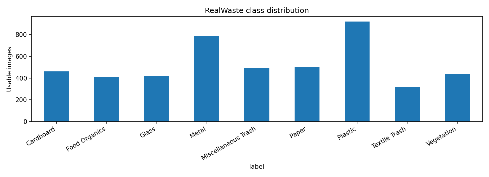
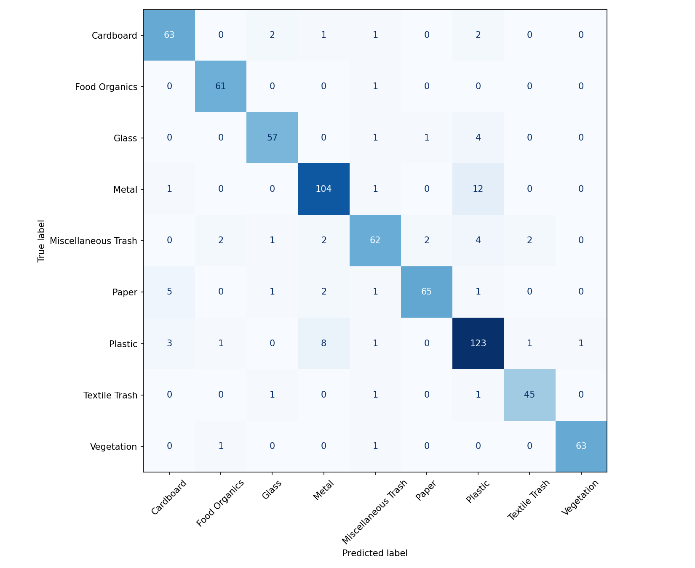
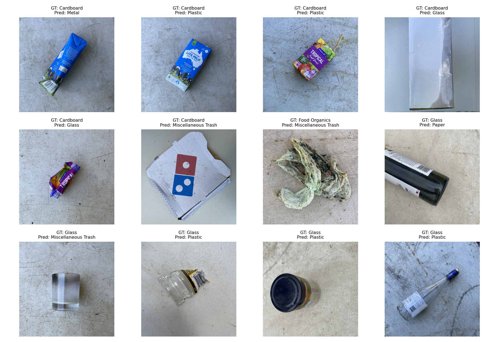

# WasteSort Mini · AI Material Explorer

**Day 41 / 100 Days of Projects** · [English documentation](docs/en/README.md) · [Dokumentasi Bahasa Indonesia](docs/id/README.md) · [Experiment notebook](notebooks/WasteSort_Day41_Kaggle.ipynb)

> **Research prototype, not a recycling authority.** This tool recognizes visual categories seen in the RealWaste dataset. It cannot verify resin chemistry, hazardous waste handling, local recycling eligibility, or safe disposal requirements.

## Executive summary

WasteSort Mini is a locally runnable, nine-class waste-material image classification application. A **MobileNetV3-Small** model trained on **UCI RealWaste** powers a **FastAPI** inference service and a **React 19 / Vite / TypeScript** interface. The app accepts a single JPG, PNG, or WebP photo (up to 10 MB), displays ranked softmax scores and material-specific cautionary guidance, and stores recent scan summaries only in React session state.

**Current maturity:** notebook training and held-out evaluation completed; model checkpoint is stored **locally**, not in Git; backend and frontend code are in this repository; local development screenshots exist; public deployment, independently validated field accuracy, and calibration are **not established**.

### Verified experimental results

| Evidence | Value | Source |
|---|---:|---|
| Usable RealWaste images | **4,752** | [Run manifest](reports/run_manifest.json) |
| Split (train / validation / test) | **3,326 / 713 / 713** | [Run manifest](reports/run_manifest.json) |
| Baseline validation macro-F1 | **33.50%** | [Champion selection](reports/champion_selection.json) |
| MobileNetV3 validation macro-F1 | **90.26%** | [Champion selection](reports/champion_selection.json) |
| **Held-out test accuracy** | **90.18%** | [Test metrics](reports/heldout_test_metrics.json) |
| **Held-out test macro-F1** | **91.03%** | [Test metrics](reports/heldout_test_metrics.json) |
| Champion checkpoint | **Epoch 12** | [Champion selection](reports/champion_selection.json) |
| TrashNet shifted-domain subset accuracy | **35.44%** across 2,390 images | [External evaluation](reports/trashnet_external_check.json) |

**Interpretation:** high in-dataset performance does not imply cross-dataset generalization; the external result is based on a five-class comparison and a model that still outputs nine classes. Class mapping and domain differences limit direct comparisons.

## Problem, audience and scope

A single waste photograph can be difficult to categorize consistently, while practical recycling advice varies across municipalities. This demonstrator gives learners and prototype builders a visual category estimate plus a reminder to verify local rules. Intended users: students, ML engineers, sustainability educators and exploratory pilot users. **Not intended for** hazardous-waste classification, industrial sorting without validation, resin identification, chemical identification, compliance, or municipal policy decisions.

**Research questions:** Can a pretrained lightweight classifier outperform a non-deep baseline on RealWaste? Does it generalize to a different waste-image collection? Can the trained model be served through a reproducible local browser/API workflow?

## System architecture

```mermaid
flowchart LR
    U[Browser photo] --> F[React / Vite UI]
    F -->|multipart POST /api/v1/predict| A[FastAPI]
    A --> V[Decode / validate / EXIF transpose]
    V --> T[Resize 256 / center crop 224 / normalize]
    T --> M[MobileNetV3-Small .pt checkpoint]
    M --> P[Softmax rankings + sorting caution]
    P --> F
    A -->|GET| H[/health /ready /model]
```

**Inference contract:** RGB input; EXIF transpose; resize shortest side to 256, center crop to 224×224, ImageNet normalization, exact class mapping embedded in the checkpoint. The API does not download a model and does not intentionally persist uploaded images. Browser history is in-memory and is lost on reload. Scores are **uncalibrated softmax probabilities** and should not be read as verified confidence.

## Implemented features and evidence

| Capability | Status / qualification |
|---|---|
| Nine-category model training | Implemented in Kaggle notebook; experiment artifacts committed as JSON/CSV/plots |
| Upload, drag/drop, preview, reset | Implemented in `frontend/src/App.tsx` |
| MIME and 10 MB upload validation | Implemented client and server side |
| MobileNetV3 checkpoint loading | Implemented in `backend/app/main.py`; requires trusted local `.pt` file |
| API health/readiness/model metadata | Implemented; readiness true only after loading checkpoint |
| Ranked prediction and guidance | Implemented; suggestions are not official disposal rules |
| Recent scan list | Implemented in-memory only; no database |
| Local browser screenshots | Present in `assets/screenshots/`; do not establish deployment |
| Automated tests | Health, readiness response shape and model metadata tests exist; exhaustive real-checkpoint e2e testing not evidenced |
| Public deployment, user accounts, production monitoring | Not implemented / not demonstrated |

## Data and scientific method

### Primary and external sources

- **Primary:** [UCI RealWaste, dataset 908](https://archive.ics.uci.edu/dataset/908/realwaste), nine categories, 4,752 usable images. Experiment path: `/kaggle/input/datasets/wafabila/wastesort-mini-dataset/realwaste_uci/realwaste-main/RealWaste`. The experiment provenance reports **CC BY 4.0**; confirm upstream attribution terms before republishing imagery.
- **External:** [TrashNet](https://github.com/garythung/trashnet), test of cross-domain transfer; experiment path: `/kaggle/input/datasets/wafabila/wastesort-mini-dataset/trashnet_images/dataset-resized`. **Its redistribution license has not been verified in this repository.** It is not the main training dataset.

**Exact class taxonomy:** Cardboard, Food Organics, Glass, Metal, Miscellaneous Trash, Paper, Plastic, Textile Trash and Vegetation.

**Leakage strategy:** image-level stratification after grouping exact decoded RGB pixel hashes. [Leakage report](reports/leakage_audit.json) records zero exact-hash split overlap and zero recorded duplicate-pixel extras. **Near duplicates and source/scene/group independence are not fully established.** No random train/test reshuffle should be made during replication.

**Champion selection:** a classical baseline was compared with MobileNetV3 using **validation macro-F1 only**; held-out test was evaluated after selection. Full training settings should be read from [the versioned notebook](notebooks/WasteSort_Day41_Kaggle.ipynb), not inferred from website copy. The recorded run used seed 42 and Kaggle Python 3.13.16, PyTorch 2.11.0+cu130 and torchvision 0.26.0+cu130.

### Per-class held-out results

| Class | Test images | F1 |
|---|---:|---:|
| Cardboard | 69 | 89.36% |
| Food Organics | 62 | 96.06% |
| Glass | 63 | 91.20% |
| Metal | 118 | 88.51% |
| Miscellaneous Trash | 75 | 85.52% |
| Paper | 75 | 90.91% |
| Plastic | 138 | 86.32% |
| Textile Trash | 48 | 93.75% |
| Vegetation | 65 | 97.67% |

The lowest recorded per-class F1 values are **Miscellaneous Trash (85.52%)** and **Plastic (86.32%)**. Review the actual confusion matrix and error gallery before drawing stronger conclusions.

### Evidence visuals


*Class distribution from the recorded RealWaste experiment.*


*Held-out RealWaste classification errors; see numerical metrics in `reports/heldout_test_metrics.json`.*


*Example failure gallery: individual predictions must not be presented as universally representative.*


*Repository screenshot of the local development interface; public deployment is not implied.*

Nine `assets/examples/manual_test/` RealWaste images have also been committed. **Before redistribution/public use, confirm source attribution and licensing, and consider excluding them from the code repository if the required permissions are unclear.** They are UI smoke-test assets, not independent validation evidence.

## Repository layout

```text
WasteSort-Mini/
├── README.md · AGENTS.md · LICENSE · .env.example · .gitignore
├── README_APP.md
├── notebooks/       # Kaggle experiment notebook
├── models/          # checkpoint is local, intentionally gitignored
├── reports/         # JSON/CSV experimental evidence
├── assets/          # plots, examples, screenshots, diagrams
├── backend/         # FastAPI and basic tests
├── frontend/        # React + TypeScript + Vite
├── docs/            # English and Indonesian manuals
└── scripts/         # Windows startup scripts
```

## Local setup — Windows PowerShell 5.1

**Requirements:** Python compatible with installed PyTorch/torchvision, Node.js/npm, supported CPU/GPU, enough disk space for model/runtime. Checkpoint must come from the trusted Day 41 Kaggle run. Python 3.11 is used by the included backend startup script; actual package versions depend on the environment.

**Terminal 1 — backend:**

```powershell
cd "D:\porto@ day\day 41"
powershell.exe -NoProfile -ExecutionPolicy Bypass -File ".\scripts\START_BACKEND.ps1"
Invoke-RestMethod "http://127.0.0.1:8000/api/v1/ready"
```

The backend expects `models/mobilenetv3_best.pt` with `{'model': state_dict, 'classes': nine_class_names}`. A missing/incompatible checkpoint yields `ready: false` and prediction requests return HTTP 503. The backend runs on `127.0.0.1:8000` and exposes interactive API docs at `http://127.0.0.1:8000/docs`.

**Terminal 2 — frontend:**

```powershell
cd "D:\porto@ day\day 41rontend"
npm.cmd install
npm.cmd run build
npm.cmd run dev -- --host 127.0.0.1 --port 5173
```

Open `http://127.0.0.1:5173`. Frontend API base defaults to `http://127.0.0.1:8000`; override with `VITE_API_BASE_URL` in a local `.env`. Run `npm.cmd run build` to verify TypeScript/Vite compilation. `frontend/src/vite-env.d.ts` is present and enables Vite's `import.meta.env` typings.

**Backend tests:**

```powershell
cd "D:\porto@ day\day 41ackend"
.\.venv\Scripts\python.exe -m pip install pytest httpx
.\.venv\Scripts\python.exe -m pytest -q
```

**Live API smoke test:**

```powershell
Invoke-RestMethod http://127.0.0.1:8000/api/v1/health
Invoke-RestMethod http://127.0.0.1:8000/api/v1/ready
Invoke-RestMethod http://127.0.0.1:8000/api/v1/model
```

Health OK alone **does not prove model readiness**. Prediction validity requires a trusted checkpoint, matching transforms/classes and an actual sample-image request; performance claims require independent evaluation beyond a single working prediction.

## Before → Now → Next

| Phase | Evidence / action |
|---|---|
| Before | Collect RealWaste, audit images, build classical baseline, train MobileNetV3, evaluate TrashNet shift |
| Now | Training reports committed, local inference code and interactive UI available, development screenshots checked in |
| Next — P0 | Verify checkpoint compatibility and real-image end-to-end inference; update/extend tests |
| Next — P1 | Investigate near-duplicate and scene-group leakage; independent test on newly captured images |
| Next — P1 | Address TrashNet domain shift and calibrate uncertainty / reject low-confidence inputs |
| Next — P2 | Add public deployment only after authentication, upload limits, rate limits and monitoring are planned |

## Security and privacy

The service restricts image types and size; Pillow decodes images in memory and EXIF orientation is respected. No authentication or rate limiting is implemented. **Do not publicly bind the current API** without appropriate operational protections. Do not commit passwords, API secrets, model binaries, complete datasets, or sensitive user photos. MIT covers original software, not upstream datasets/weights. Read [limitations](docs/en/limitations.md), [deployment](docs/en/deployment.md) and [troubleshooting](docs/en/troubleshooting.md).

## FAQ

**Does 90.18% mean reliable real-world sorting?** No. The independent-domain TrashNet check was substantially weaker, and local recycling criteria differ.

**Does the app identify plastic resin?** No. `Plastic` is one broad RealWaste class.

**Does a green “Model online” badge prove correctness?** No. It confirms that a checkpoint loaded, not scientific validity.

**Why is `.pt` missing from GitHub?** Large learned weights are intentionally excluded; recreate them from Kaggle or obtain a trusted internal artifact consistent with the notebook.

**Can I use a new photo?** Yes for exploratory inference, but accuracy on that photo is unknown.

## Documentation, attribution and license

Read the [English manual](docs/en/README.md) or [panduan Bahasa Indonesia](docs/id/README.md); component docs live in `backend/`, `frontend/`, `models/`, `notebooks/`, `reports/`, `assets/` and `scripts/`. Original repository code: [MIT](LICENSE). Primary dataset: [RealWaste](https://archive.ics.uci.edu/dataset/908/realwaste). External study: [TrashNet](https://github.com/garythung/trashnet). The experiment's reported license metadata must be rechecked before distributing images or pretrained weights.
