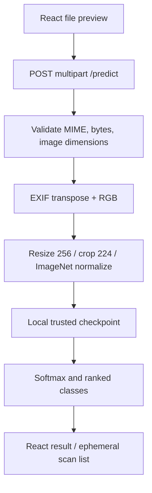

# Architecture and API contracts

[Documentation index](README.md) · [Indonesian](../id/architecture.md) · [Repository README](../../README.md)

**Browser:** React 19 + TypeScript + Vite 6 + lucide-react, implemented as a single app in `frontend/src/App.tsx`, styles in `frontend/src/styles.css`. UI state includes selected file, preview URL, request status/error, model readiness, result rankings, and up to 15 recent summaries. There is no database, persistent routing, account system, or cloud storage in source code.

**Service:** FastAPI in `backend/app/main.py` loads the checkpoint at startup into a guarded model store; `torch.inference_mode()` handles inference. `GET /api/v1/health` returns process health; `/ready` reports actual checkpoint loading status; `/model` reports class vocabulary and summary metrics; multipart `POST /predict` expects `file`, checks content type, size, actual Pillow format and pixel dimensions. Returns `label`, `confidence`, `rankings`, `tip`, `image`, `model`, `disclaimer`.

**Failure codes:** 503 model unavailable; 415 unsupported media; 413 missing/oversized image or oversized dimensions; 422 decoding error. CORS defaults to `localhost:5173` and `127.0.0.1:5173`; API listens on loopback in the startup script. No auth/rate limiting. Do not expose directly to the internet. API validation may consume at most 10 MiB + 1 byte before rejecting size; images are not intentionally stored server-side.

## Evidence and follow-up

Primary figures and code are versioned in the root repository: `reports/`, `notebooks/`, `backend/` and `frontend/`. If later experiments change results, update BOTH translations and link the new artifacts, retaining earlier reproducible evidence.
