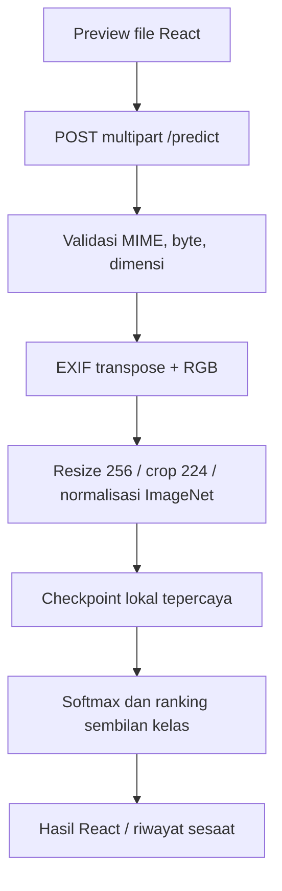

# Arsitektur sistem dan kontrak API

[Indeks dokumentasi](README.md) · [English](../en/architecture.md) · [Repository README](../../README.md)

**Browser:** React 19 + TypeScript + Vite 6 + lucide-react, aplikasi utama di `frontend/src/App.tsx`, CSS di `frontend/src/styles.css`. State UI mencakup file, URL preview, status/error request, readiness model, daftar skor, dan maksimal 15 ringkasan scan. Tidak ada database, routing multipage persisten, akun atau penyimpanan cloud dalam kode.

**Server:** FastAPI di `backend/app/main.py` memuat checkpoint saat startup ke model store yang memakai lock; inferensi melalui `torch.inference_mode()`. `GET /api/v1/health` untuk status proses; `/ready` menunjukkan status pemuatan checkpoint; `/model` mengirim daftar kelas/metrik; multipart `POST /predict` menerima `file`, mengecek MIME, ukuran, format asli Pillow, dimensi. Respons berisi `label`, `confidence`, `rankings`, `tip`, `image`, `model`, `disclaimer`.

**Kode kegagalan:** 503 model belum siap; 415 media tak didukung; 413 file kosong/terlalu besar/dimensi berlebih; 422 gagal decoding. CORS default `localhost:5173` dan `127.0.0.1:5173`; script memulai API pada loopback. Belum ada auth/rate limit; jangan dibuka langsung ke internet. Server membaca maksimal 10 MiB + 1 byte sebelum menolak ukuran. Foto tidak sengaja disimpan secara permanen.

## Bukti dan tindak lanjut

Angka dan kode asli terlacak dalam `reports/`, `notebooks/`, `backend/`, dan `frontend/` di root repository. Jika eksperimen baru mengubah hasil, perbarui KEDUA bahasa serta tautkan artefak baru tanpa menghapus bukti lama yang dapat direproduksi.
